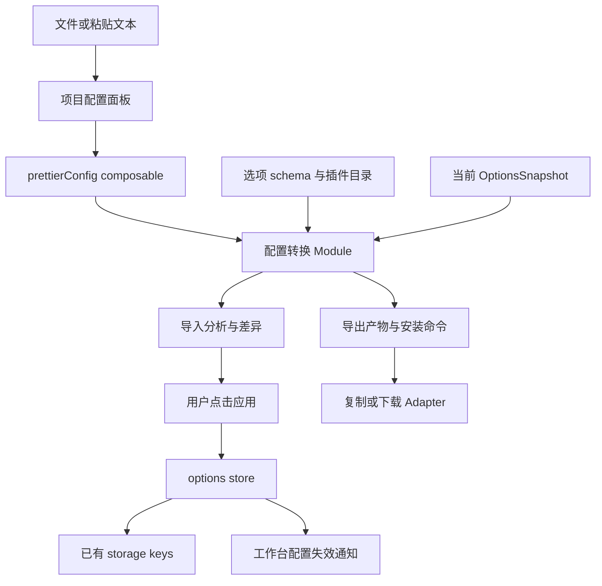
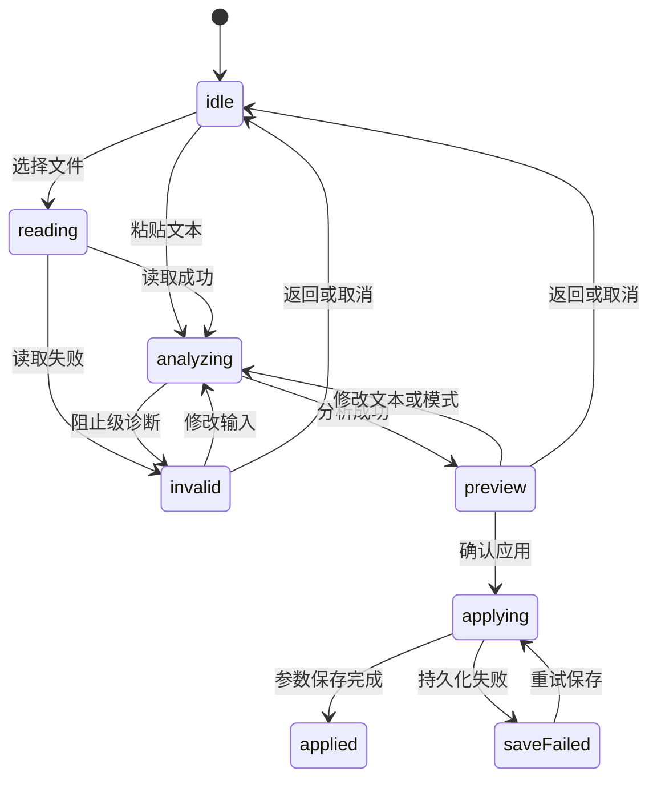

# Prettier 配置导入与导出：代码设计

状态：设计提案，以下文件、类型和函数除明确标为现有外均为拟新增或拟修改。日期：2026-09-22。

仓库基线：`fc32a1f`。对应需求：[功能设计](./prettier-config-functional-design.md)。本文只设计实现，不表示功能已经落地。

## 1. 当前调用链与约束

| 现有文件                                                | 职责                            | 设计影响                                       |
| ------------------------------------------------------- | ------------------------------- | ---------------------------------------------- |
| `components/OptionsPresetPanel.vue`                     | 预设、备份导入导出、重置        | 添加项目配置入口，保留原业务                   |
| `components/settings/SettingsContent.vue`               | 组合各设置区块                  | 承载子面板状态，避免模态嵌套                   |
| `components/settings/SettingsDialog.vue`                | 工作台设置容器                  | 根据子面板切换标题和返回按钮                   |
| `entrypoints/options/pages/options.vue`                 | 独立设置页                      | 复用同一设置内容                               |
| `stores/options.ts`                                     | 单项格式化参数、预设及快照      | 仍是已应用设置的唯一来源                       |
| `utils/optionsPreset.ts`                                | v1 快照验证、序列化、预设操作   | 抽出共用选项 schema，保留备份协议              |
| `composables/storage.ts`                                | 单 key 初始化和异步持久化       | 需暴露初始化与保存状态以支持可靠预览和失败反馈 |
| `utils/formatOptions.ts`                                | 网页格式化时从存储读取参数      | 导入继续使用现有 key；Pug 扩展时必须同步修改   |
| `stores/workspace.ts`                                   | 拼接所有参数并调度格式化        | 配置变更后让旧请求失效、标记结果过期           |
| `utils/format.ts`、`utils/cache.ts`                     | standalone 调用、白名单插件加载 | 不接收导入文件中的插件路径或动态执行代码       |
| `components/DropZone.vue`、`composables/fileHandler.ts` | 拖拽与文件格式化分发            | P1 增加意图路由；P0 仅协调设置打开时的事件接管 |

现有 `applySnapshot()` 是同步逐字段赋值，持久化由多个 `useStorage()` watcher 异步完成；它不是浏览器存储事务。当前 `useStorage()` 不向调用方暴露初始化完成、保存成功和保存失败，且没有跨窗口订阅。设计不得把这些能力写成已存在。

Prettier 项目配置中的 `plugins` 是插件声明；扩展格式化时需要传入已打包的插件对象。两者不能直接互相赋值。[插件文档](https://prettier.io/docs/plugins)、[浏览器文档](https://prettier.io/docs/browser)

## 2. 模块划分

以一个配置转换 Module 隐藏解析、选项归属、默认值比较和诊断规则。Vue 组件只消费分析结果，不自行解释配置。



对外 Interface 收敛为三个操作：

| 函数                         | 输入                                     | 输出                                 | 副作用 |
| ---------------------------- | ---------------------------------------- | ------------------------------------ | ------ |
| `analyzePrettierConfig`      | 文本、格式、当前快照、导入模式、目录数据 | 合法候选快照、差异、诊断，或失败结果 | 无     |
| `createPrettierConfigExport` | 当前快照、插件选择、精简开关、目录数据   | JSON、依赖列表、诊断                 | 无     |
| `createInstallCommand`       | 已验证的依赖列表、包管理器               | 一条安装命令                         | 无     |

文件读取和存储是实际变化的 Adapter；不要再创建空壳 service、全局事件总线或插件容器。测试通过同一 Interface 验证行为。

### 2.1 拟议文件结构

```text
components/settings/
  SettingsContent.vue                    修改：管理主面板/导入/导出切换
  SettingsDialog.vue                     修改：标题、返回、焦点
  config/
    ProjectConfigImportPanel.vue         文件/粘贴、模式、应用操作
    ProjectConfigExportPanel.vue         插件选择、精简开关、导出操作
    ConfigDiagnostics.vue               诊断列表和兼容性说明
    ConfigChangesTable.vue              当前值与候选值比较
    ConfigTextPreview.vue               只读文本和复制反馈
components/OptionsPresetPanel.vue        修改：语义明确的入口事件
composables/prettierConfig.ts             会话状态、异步文件读取、确认应用
constants/prettierConfig.ts               插件元数据、能力与限制
constants/prettierConfigMetadata.json     构建依赖的版本和默认值快照
types/prettierConfig.ts                   转换协议及诊断类型
utils/optionsSchema.ts                   共用核心/语言分组 schema
utils/prettierConfig/
  index.ts                               三个对外操作
  parse.ts                               JSON/YAML 解析和输入限制
  analyze.ts                             归属、验证、候选快照与差异
  export.ts                              可移植字段筛选和精简
  installCommand.ts                      可信依赖到命令的映射
scripts/generatePrettierConfigMetadata.ts  开发时生成版本与元数据
tests/utils/prettierConfig.test.ts
tests/constants/prettierConfig.test.ts
tests/composables/prettierConfig.test.ts
tests/components/projectConfig.test.ts
tests/integration/prettierConfig.test.ts
tests/fixtures/prettier-config/
```

解析和导出实现可在小规模时合并文件；对外三函数 Interface 不变。不要仅为目录对称增加转发文件。

## 3. 领域模型

### 3.1 三类数据分离

| 模型                    | 用途                                 | 生命周期                  |
| ----------------------- | ------------------------------------ | ------------------------- |
| `OptionsSnapshot`       | 扩展完整格式化参数，现有 v1 分组协议 | 存储、预设、备份          |
| `ProjectConfigDocument` | 原始静态配置对象及来源信息           | 当前导入会话；P0 不持久化 |
| `ProjectConfigExport`   | 面向项目的扁平 JSON、依赖、诊断      | 当前导出会话              |

项目配置中不能出现 `xmlPluginOptions` 等分组键。相反，不能把导入的扁平对象直接展开到 store 或 `formatViaPrettier()`。

### 3.2 类型草案

下列草案展示核心约束；实现时补齐所有 TSDoc、schema 和必要的只读约束。

```ts
export type ConfigPluginId = 'xml' | 'php' | 'java' | 'svelte' | 'toml' | 'pug'

export type ConfigImportMode = 'merge' | 'reset-extension-defaults'

/**
 * Exact snapshot groups without the inherited JSON index signature.
 */
export type OptionsGroupMap = Pick<
  OptionsSnapshot,
  | 'options'
  | 'xmlPluginOptions'
  | 'phpPluginOptions'
  | 'javaPluginOptions'
  | 'sveltePluginOptions'
  | 'tomlPluginOptions'
>

/**
 * Validated partial values grouped like the existing snapshot.
 */
export type OptionsPatch = {
  [Key in keyof OptionsGroupMap]?: Partial<OptionsGroupMap[Key]>
}

/**
 * A diagnostic produced without changing application state.
 */
export interface ConfigDiagnostic {
  /**
   * Stable diagnostic code used to select localized copy.
   */
  code: ConfigDiagnosticCode

  /**
   * Whether this blocks applying, needs acknowledgement, or is informational.
   */
  severity: 'error' | 'warning' | 'info'

  /**
   * Path such as ["plugins", 1] or ["overrides", 0].
   */
  path: ReadonlyArray<string | number>

  /**
   * Safe value preview; the UI truncates long values.
   */
  value?: JsonValue

  /**
   * Optional one-based source line.
   */
  line?: number

  /**
   * Optional one-based source column.
   */
  column?: number
}

/**
 * Analysis result used by the import panel.
 */
export type ConfigImportAnalysis =
  | {
      /**
       * Parsing or value validation failed.
       */
      status: 'invalid'

      /**
       * Reasons the document cannot be applied.
       */
      diagnostics: ConfigDiagnostic[]
    }
  | {
      /**
       * The candidate is valid or there is nothing to apply.
       */
      status: 'ready' | 'no-change' | 'no-applicable-options'

      /**
       * Entire validated candidate; never spread untrusted source into it.
       */
      candidate: OptionsSnapshot

      /**
       * Option-by-option changes from the captured base snapshot.
       */
      changes: ConfigOptionChange[]

      /**
       * Recognized plugins in deterministic order.
       */
      pluginIds: ConfigPluginId[]

      /**
       * Unsupported content and informational findings.
       */
      diagnostics: ConfigDiagnostic[]

      /**
       * Whether applying requires explicit acknowledgement of omissions.
       */
      requiresAcknowledgement: boolean
    }
```

现有 `OptionsSnapshot extends JsonObject` 带字符串索引签名，因此先通过 `OptionsGroupMap` 明确列出六个已知分组，再映射为 partial；不直接对快照使用 `keyof`，防止任意字符串键被类型系统接受。

补充类型约定：

- `ConfigOptionChange`：`group`、`key`、`before`、`after`，两侧都是 JSON 值，不用格式化后的字符串做比较。
- `ProjectConfigDocument`：`sourceName`、`format`、`root`，其中 `root` 仅在语法解析后建立；原始文本留在会话状态。
- `ProjectConfigExport`：`fileName`、`text`、`dependencies`、`diagnostics`；`fileName` 固定 `.prettierrc.json`。
- `ConfigDependency`：白名单 `packageName` 与构建解析的 `version`；不能由任意导入内容创建。
- `ConfigDiagnosticCode` 为字符串联合，由固定 code 映射 i18n 文案，不把中文写入纯转换逻辑。
- 配置索引使用 `Map` 或安全的自身属性查找；禁止通过输入键访问原型链。

## 4. 插件目录与选项 schema

### 4.1 插件目录

每个登记项包含：

| 属性                       | 含义                                   |
| -------------------------- | -------------------------------------- |
| `id`                       | `xml` 等稳定标识                       |
| `packageName`              | 项目安装和 `plugins` 的标准包名        |
| `acceptedImportNames`      | 有限、显式的别名，如现有浏览器入口     |
| `languageIds`              | 扩展对应的语言                         |
| `snapshotGroup`            | 保存选项的分组，Pug 首期为空           |
| `optionKeys`               | 当前能够保存和往返转换的字段           |
| `recognizedOnlyKeys`       | 插件存在但扩展尚不能保存的字段         |
| `legacyKeys`               | 历史配置字段及迁移说明                 |
| `coreDefaultOverrides`     | 插件声明会改变的核心默认值             |
| `runtimeDefaultOptionKeys` | 内部运行参数；只在验证后决定是否可移植 |

目录属于构建内可信数据，插件选项归属不能依赖 `key.startsWith('pug')`。未知键保留诊断。

建立 `Map<optionKey, owner>`。核心字段优先属于核心，例如 `singleQuote`；如果两个第三方插件登记了同名非核心选项且语义不一致，生成元数据或测试时直接失败，要求人工明确适用范围，不能用最后一个插件覆盖前一个。

识别 `@prettier/plugin-php/standalone` 和 `prettier-plugin-svelte/browser` 时可以规范化到标准包名，并产生提示。相对路径、绝对路径、URL、`package@version`、未知子路径不猜测转换，也不调用 `import()`。

### 4.2 schema 复用

从现有 `OptionsSnapshotSchema` 提取：

- `CoreOptionsSchema`
- `XmlOptionsSchema`
- `PhpOptionsSchema`
- `JavaOptionsSchema`
- `SvelteOptionsSchema`
- `TomlOptionsSchema`

完整快照继续使用必填 schema。导入 patch 使用同一组选项的 partial schema，避免把 `false`、`0`、空数组误判成缺失。已知值不支持与类型非法通过插件元数据和本地 schema 的双重分类区分。

未知字段在 schema 丢弃额外字段之前收集。最终应用必须使用 `safeParse(...).output`，不能验证成功后又返回未经归一化的原始对象。

PHP `auto` 等兼容性扩大不在本任务中偷偷修改 store 值域；先产生明确诊断。未来扩展值域时同时修改类型、schema、设置 UI、默认值和行为测试。

## 5. 依赖版本与默认值元数据

### 5.1 数据来源

开发时脚本读取实际安装版本、Prettier support info，以及每个插件的 `options` 和 `defaultOptions`，生成小型静态元数据文件。浏览器仅加载该文件，不为打开导出面板而加载所有格式化插件。

`package.json` 中的 `^3.9.8` 是范围，不是安装命令应使用的精确版本。元数据记录已解析版本；依赖升级后重新生成并纳入版本控制。CI 验证元数据与安装版本一致，差异必须提交。

插件元数据可能存在默认值描述数组、没有默认值或环境相关值，脚本不能盲目取数组最后一项。对 Pug 数组选项等特殊形式建立经验证的归一化规则，无法归一化时记录为 `unknown`。

### 5.2 三种默认值

| 默认值                    | 用途                 | 示例                             |
| ------------------------- | -------------------- | -------------------------------- |
| 扩展出厂值                | 重置、旧备份迁移     | `endOfLine: auto`、PHP `7.0`     |
| Prettier / 插件声明默认值 | 精简导出和兼容性判断 | `endOfLine: lf`、PHP `auto`      |
| 运行环境相关默认值        | 需要保守处理         | 自动探测 PHP 版本、Pug framework |

默认值被插件修改时，P0 选择保守策略：相关核心字段始终显式导出。例如选择 PHP 后保留 `tabWidth`，选择 Java 后保留 `arrowParens`。这避免实现未经验证的多插件默认值优先级解析器。

### 5.3 Java 与 Pug 的特殊处理

本地 Java 2.10.4 的 `options` 未声明旧 `entrypoint`。P0 将其列为 legacy，备份仍保存，项目导入时报告不支持并排除，项目导出也排除；导出时值偏离扩展默认值才产生 warning。后续若行为验证证实可移植，再通过目录明确启用，不能只依据历史 TS 类型。

Pug 的 `PUG_DEFAULT_FORMAT_OPTIONS` 中三个空数组是现有运行适配。首期不把它们作为用户配置无条件输出。集成测试确认省略它们时项目环境的标准插件行为是否符合预期；不符合时才登记必要的可移植值或展示阻止等价承诺的诊断。

## 6. 输入解析与诊断

建议增加 `yaml` 为显式运行依赖，以便解析 YAML 数据和保留位置诊断；不要从传递依赖导入，也不要把 Prettier YAML 格式化插件当配置解析器。该库提供文档 AST、重复键检查和位置追踪，支持现代浏览器。具体版本在实施时按仓库依赖策略锁定，并验证浏览器构建。[yaml 官方文档](https://eemeli.org/yaml/)

解析步骤：

1. 校验文件或 UTF-8 文本大小，限制 1 MiB；去除 UTF-8 BOM。
2. 根据已选择格式或明确文件扩展名决定 JSON / YAML。
3. 对无扩展名 `.prettierrc`：去除前导空白后，以 `{` / `[` 开头优先进入严格 JSON；失败直接报告，不在损坏 JSON 后自动换成 YAML。
4. 无扩展名但内容使用 YAML flow mapping 时，允许用户显式改选 YAML 后重新分析。
5. JSON 先由 `JSON.parse` 检查严格语法，再用 `yaml.parseDocument` 的 JSON schema 和 `uniqueKeys: true` 检查重复键及取得位置；语义值只采用前者结果。AST 检查完成前不进入字段分析。测试确认拒绝注释、尾逗号及转义后同名的重复键，避免把 YAML 的宽松语法混入 JSON 输入。
6. YAML 使用 `parseDocument`，明确 YAML 1.2 core schema、唯一键和位置追踪；检查 `document.errors`，拒绝多文档、自定义标签及 merge key。转换前先检查 AST 深度，转换时限制 alias 展开，之后再验证 JSON 值树；不接受循环结构、非字符串映射键或非有限数值。
7. 限制结果深度 32、总节点数 10,000；YAML alias 上限 50。任一超限返回输入限制错误。
8. 根值必须是普通对象，不能是字符串共享配置、数组或 `null`。
9. 所有层级禁止 `__proto__`、`constructor`、`prototype` 等危险键，防止后续合并进入原型链。
10. `package.json` 明确提取 `prettier` 自身属性；不遍历依赖或脚本。
11. 识别备份形状，再交给备份解析器；仅有 `version` 字段不足以认定是备份。

保留结构化诊断，建议至少包括：

| code                                         | 级别    | 用途                           |
| -------------------------------------------- | ------- | ------------------------------ |
| `invalid-syntax` / `duplicate-key`           | error   | 无法可靠解析                   |
| `invalid-root` / `invalid-structure`         | error   | 根或结构字段类型不对           |
| `invalid-option-value`                       | error   | 已支持字段值非法               |
| `input-limit-exceeded`                       | error   | 文件、深度或展开超限           |
| `unsupported-format`                         | error   | 可执行配置等不支持格式         |
| `unsupported-plugin`                         | warning | 插件未集成或入口不可解析       |
| `unsupported-option`                         | warning | 未建模或未知选项               |
| `unsupported-option-value`                   | warning | 上游支持而本地模型未支持       |
| `unsupported-overrides`                      | warning | 按文件规则未执行               |
| `runtime-option-not-importable`              | warning | parser、范围等不能写入全局配置 |
| `legacy-option-not-exportable`               | warning | 旧字段不能保证可移植           |
| `plugin-inferred` / `plugin-name-normalized` | info    | 有明确推断依据的规范化         |
| `backup-file-detected`                       | info    | 提示切换备份流程               |

P0 对 `overrides` 仅检查外层为数组、条目为对象，`files` / `excludeFiles` 为字符串或字符串数组、`options` 为对象，之后整块排除。结构不合法是 error；内容不执行，不展开为全局配置。

## 7. 导入分析算法

```text
analyze(source, sourceKind, baseSnapshot, mode, catalog)
  -> parseAndValidateDocument
  -> classify structural metadata, plugins, options, unsupported content
  -> validate supported partial groups
  -> if blocking diagnostics: return invalid
  -> count applicable source options
  -> if count == 0: return no-applicable-options
  -> choose base: current snapshot OR extension defaults
  -> assign only validated own properties to known groups
  -> validate full OptionsSnapshot
  -> diff original current snapshot against candidate
  -> return ready/no-change + candidate + diagnostics
```

关键不变量：

- 不修改输入对象；源对象永远不直接传给 store。
- 不使用 `{ ...current, ...rawConfig }`。
- 合并在分组内部逐键执行，不能用 partial 分组覆盖完整分组。
- 未声明字段不等于声明 `null`；`null` 只有 schema 明确允许才合法。
- `plugins` 识别只提供能力说明，P0 不改变扩展支持哪些语言。
- 只由已验证选项建立候选；不能应用字段仍保留诊断路径和展示值。
- 选择 reset 模式前先检查至少存在一个可应用字段，防止未知配置导致全局重置。
- warning 的确认状态属于 composable，不属于纯分析函数；每次分析结果变化后重新确认。

P0 不持久化原始配置文档，故导入再导出不是原文往返。核心保证是：受支持、有效且已应用的字段，在相同导出插件范围和明确导出模式下保持语义值一致。

## 8. 项目导出算法

```text
createExport(snapshot, selection, catalog)
  -> validate snapshot and selected plugin ids
  -> collect portable core keys
  -> collect portable keys from selected plugin groups
  -> identify legacy or non-portable values and diagnostics
  -> if minimal:
       keep values with unknown/context-dependent defaults
       keep core keys touched by selected plugin default overrides
       remove only values demonstrably equal to target defaults
  -> attach canonical plugin package names in registry order
  -> sort ordinary keys lexicographically
  -> serialize with two spaces and one trailing newline
  -> derive dependencies from trusted package metadata
```

比较使用 JSON 值的结构相等，不用引用相等，不把数组转换成字符串排序后比较。未来 Pug 数组选项必须保持用户给定顺序。

插件数组顺序固定，并同时用于测试、预览和命令生成。P0 不支持任意顺序排列插件，也不承诺任意第三方插件组合。

导出 JSON 不经过用户当前 Prettier 设置再次格式化，避免 `tabWidth`、插件或自身配置影响生成文件。只使用确定性的 JSON 序列化。

安装命令的包名与版本均来自构建目录；输入文件中的未知包名、URL、引号和 shell 元字符不能进入命令。支持四种固定模板，不需要通用 shell 命令生成器。

项目配置不强制输出 `$schema`，也不输出扩展版本号。Prettier 与插件版本显示在面板并体现在安装命令中。

## 9. Vue 组件与 composable Interface

### 9.1 组件职责与数据流

| 组件                       | 输入                   | 事件                                                          | 职责                       |
| -------------------------- | ---------------------- | ------------------------------------------------------------- | -------------------------- |
| `OptionsPresetPanel`       | 无新增领域状态         | `importProjectConfig`、`exportProjectConfig`、`restoreBackup` | 展示入口及原预设操作       |
| `SettingsContent` | 宿主持有的 `view` | `update:view` | 请求视图切换并组合对应面板 |
| `ProjectConfigImportPanel` | 会话 composable 返回值 | `back`、`applied`                                             | 文件/粘贴、差异、确认应用  |
| `ProjectConfigExportPanel` | 当前快照、目录         | `back`                                                        | 插件勾选和输出             |
| `ConfigDiagnostics`        | 只读 diagnostics       | 无                                                            | i18n 与字段路径展示        |
| `ConfigChangesTable`       | 只读 changes           | 无                                                            | 展示变化，不修改设置       |
| `ConfigTextPreview`        | `text`、`fileName`     | `copy`                                                        | 可选择的只读文本和复制入口 |

`view` 取值 `overview | import-project | export-project | restore-backup`。用局部状态而非新增路由实现；独立设置页已有路由继续负责页面导航。

`SettingsContent` 接收 `v-model:view`，宿主持有唯一值并据此更新 Dialog 标题，避免维护两份视图状态。独立设置页同样在宿主持有该值。

组件使用 Composition API、`<script lang="ts" setup>`。派生数据用 `computed`，原始文本、读取状态等用 `shallowRef`；分析对象整体替换。Props 只读，事件向上传递，不通过组件 ref 修改子组件内部状态。

### 9.2 导入会话状态机



用 `requestId` 使旧 `file.text()` / 异步解析结果失效。选择新文件、切换输入方式、返回或卸载均递增 id；完成时检查 id，不能让较慢的旧请求覆盖新预览。

点击应用前再次读取 store 快照，与分析时的 `baseSnapshot` 结构比较；变化则重新分析并清除 warning 确认。一次应用只允许一个进行中请求，按钮禁用防止重复提交。

导出快照也必须等待初始化完成。刷新前的快照与文本成对保存；复制和下载只消费当前可见产物，不重新计算另一份配置。

## 10. 参数应用、存储与格式化一致性

### 10.1 P0 的最小可靠改造

保留已有 `local:<optionKey>`，避免这次功能强制迁移全量存储。为 `useStorage` 增加可选的生命周期观察能力，由 options store 内的写入跟踪器聚合：

- `ready`：所有参数初始化完成；失败状态与「还没完成」区分。
- 每个参数写入按 key 串行排队，记录 revision、pending、error。
- `flush`：等待调用时已提交的相关写入完成，失败向上返回；当前日志继续保留。
- 未提供观察器的调用方保持原 Interface 和行为，避免无关 store 重构。

跟踪器只服务 options store，不依赖 UI。`useStorage` 在安排 watcher 写入时记录任务，不能在 `flush()` 已返回后才发现本次写入。

store 新增 `applyImportedSnapshot(candidate, expectedBase)`：

1. 等待初始化完成，重新验证候选和 `expectedBase`。
2. 保存当前快照供失败说明和重试，计算完整差异。
3. 调用现有 `applySnapshot()` 同步更新内存参数。
4. 等待 Vue watcher 调度，随后等待本次写入 revision 的 `flush()`。
5. 成功返回；失败返回明确的 `save-failed`，候选仍为当前页面值，允许重试持久化。

需要明说：这提供的是「先完整验证，再应用，并等待保存结果」，**不提供跨 key 的崩溃原子性或跨窗口事务**。保存中断可能留下部分持久化值。失败提示不能声称完全回滚；用户应重试全部候选键的持久化。

成功提示只在保存完成后出现。保存失败时提示当前页面参数已应用但持久化失败；该会话保留重试按钮。其他工作台已有内存设置不会自动同步，沿用当前行为并在需要时提示重新打开。

若未来需求必须保证原子切换，应单独迁移为一个版本化快照 key，同时更新 `readStoredFormatOptions()`，而不是给本功能悄悄叠加多 key 事务假象。

### 10.2 工作台行为

现有 workspace 把不同插件组选项一起展开。P0 不顺便改变这个运行策略，降低新增功能与格式化行为变更的耦合；导出仍按用户选择过滤插件参数。

增加格式化配置 revision：

- 设置变化时递增 revision，使当前进行中的旧请求失效。
- `formatJob()` 同时捕获请求 id 和配置 revision。
- 成功、失败两条回写路径都检查 revision，旧请求不得写入结果、错误、日志或历史。
- 对原来处于 `formatting` 的任务恢复为可重新执行状态，避免永久转圈。
- 已完成结果保留用于查看，但标记配置过期；重新格式化后清除标记。
- 正在运行的批量任务停止剩余项，提示配置已变化，防止同一批次混用两套参数。

这项 revision 应覆盖项目导入、备份恢复、预设应用、单项设置变化，不只针对新增按钮。实现可由 store 对格式化快照变化发出单一 revision，而不是到处添加事件。

网页编辑器在下一次请求通过 `readStoredFormatOptions()` 读取新值；跨页面的参数写入过程不具有上述内存 revision，P0 仅承诺保存完成后的新请求使用更新值。

## 11. 备份兼容与未来扩展

P0 不改变 v1 快照结构。抽出 schema 后使用现有 fixture 确保备份和预设列表读取行为保持一致；项目转换和备份序列化仍是两个 Interface。

P1 增加 Pug 专属选项时必须同时覆盖：

1. `PluginPugOptions`、明确字段 schema 与默认值。
2. 设置 UI、options store、`utils/formatOptions.ts`、`FormatOptions`。
3. 工作台与网页格式化调用链；保留已有 Pug 浏览器补丁行为。
4. `OptionsSnapshotV2` 与旧备份/旧预设读取迁移。
5. 插件目录与导入导出测试；`false`、`null`、`-1`、有序数组等值不能被通用清洗丢失。

不建议引入一个未经 schema 验证的 `extraOptions: Record<string, unknown>` 承接所有未知字段。这会绕开设置、存储、导出与实际格式化之间的契约。

P2 的 `overrides` 需要独立的项目配置文档模型和解析器，包含规则顺序、`files`、`excludeFiles`、相对项目根路径、无路径手动输入的行为。先为 `FormatJob` 建立可信相对路径，再实现匹配；不能对仅有文件名的现状宣称支持目录 glob。

## 12. 测试设计

测试验证外部行为，避免通过读取实现源码匹配字符串来证明功能。

| 测试层   | 重点用例                                                                                       |
| -------- | ---------------------------------------------------------------------------------------------- |
| 解析     | JSON、YAML、BOM、package.json 提取、非对象、重复键、损坏 JSON、不执行 JS、超限、YAML aliases   |
| 字段分析 | 核心与插件字段分组、显式 false/0、未知键、非法值、PHP auto、Pug 未支持字段、插件别名、路径插件 |
| 应用模式 | merge 保留遗漏值；reset 使用扩展默认；无适用字段不触发重置；差异为零不写入                     |
| 诊断     | warnings 未确认不能应用；输入变化清空确认；overrides 不扁平化；backup 正确分流                 |
| 导出     | 标准包名、固定顺序、未选插件排除、精简/完整、未知默认值保留、内部字段不泄漏                    |
| 默认值   | `endOfLine: auto`、PHP `tabWidth: 2` 与 `phpVersion: 7.0`、Java `arrowParens` 保留             |
| 安装命令 | 四种模板、精确版本、未选择插件时仅 prettier、输入包名不能注入命令                              |
| 会话     | 异步文件乱序、卸载后返回、读取失败、预览后设置变化、复制失败后可下载                           |
| 存储     | 初始化等待、保存成功后提示、保存失败显示、重试所有候选字段、单 key 写入顺序                    |
| 工作台   | 配置变化使旧成功/失败回调失效，批量中止、结果过期、源代码不变                                  |
| Vue UI   | 两入口一致、键盘可达、返回焦点、确认状态、窄窗口布局                                           |

### 12.1 有意义的集成测试

使用当前安装的 Node Prettier 与真实插件加载导出的配置，对代表性输入比较两种调用的结果：

- 显式完整受支持选项 + 所选插件。
- 同一组选项生成的精简项目配置 + 同一插件版本。

先证明精简没有改变行为，再分别比较 extension standalone 与项目环境在承诺范围内的结果。覆盖核心 JavaScript、XML、PHP、Svelte、TOML、Java、Pug；至少对默认值会相互影响的 PHP + Java 组合增加用例。

涉及语言不可比、插件已知浏览器补丁或上游移除选项时，形成明确能力限制，不能简单更新 golden 结果掩盖差异。

往返测试应指定导入模式、导出插件范围和保留字段集合。不能用「任意原始配置导入后与导出文本完全相等」作为验收标准。

## 13. 实施顺序与验证

| 顺序 | 建议提交                                                 | 内容与可验证结果                                   |
| ---- | -------------------------------------------------------- | -------------------------------------------------- |
| 1    | `refactor: share formatting option schemas`              | 抽取 schema，备份与预设回归通过                    |
| 2    | `feat: add prettier config capability catalog`           | 插件目录、版本与默认值元数据、漂移检查             |
| 3    | `feat: analyze static prettier configs`                  | JSON/YAML 解析、字段诊断、合并候选；纯函数测试     |
| 4    | `feat: export project prettier configs`                  | 插件选择对应的序列化、精简与安装命令；真实插件验证 |
| 5    | `fix: expose formatting settings save status`            | 初始化、写入跟踪、失败反馈、可重试保存             |
| 6    | `feat: add project config settings panels`               | 两种设置入口、差异与预览、备份文案、五种语言文案   |
| 7    | `fix: invalidate results when formatting options change` | 旧请求防回写、批次停止、过期结果提示               |
| 8    | `test: verify prettier config workflows`                 | 完整导入导出与浏览器手工验证、README 支持矩阵      |

实施阶段按仓库要求执行：

```sh
rtk pnpm run test --run
rtk pnpm run lint
rtk pnpm run typecheck
rtk pnpm run build
rtk pnpm run build:firefox
```

并手工检查 Chromium / Firefox 的设置面板、复制下载、旧备份、文件拖拽与网页编辑器格式化。可见变化在 PR 附截图；本次仅新增设计文档，无需把这些实施测试写成已通过。

环境注意：当前 `AGENTS.md` 写 pnpm 11，而基线 `package.json.packageManager` 为 `pnpm@12.5.1`。设计阶段不修改二者；实施前应明确统一工具链，避免无意改写锁文件。

## 14. 设计决策记录

| 决策                         | 原因                                                 |
| ---------------------------- | ---------------------------------------------------- |
| 项目配置与备份分成两个流程   | 数据结构和使用目的不同，避免恢复覆盖被误认为项目导入 |
| 子面板复用当前设置容器       | 保留入口上下文，避免叠加模态和焦点竞争               |
| 导入默认 merge               | 尊重未声明的当前参数，并明确不模拟完整项目解析       |
| 不持久化未知字段与 overrides | 当前格式化模型不能执行，避免制造“已经支持”的假象     |
| 默认值元数据在开发时生成     | 面板无需加载所有插件，版本依赖可审查                 |
| 插件影响核心默认时保守保留   | 格式化一致性比少几个字段更重要                       |
| 首期不改快照版本             | 项目转换不要求扩展备份协议迁移                       |
| Pug 完整配置单独补齐         | 已有格式化支持不等于具有可靠的参数存储链路           |
| 不新增任意插件加载能力       | 现有白名单 loader 可直接复用，配置文件只描述参数     |

首期完成的标志是：用户能够理解将导入什么、不会导入什么，并把当前受支持的有效参数以可信的项目配置带走。
