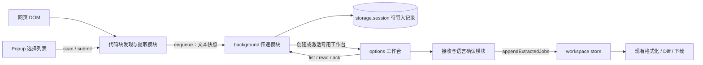

# 网页代码块提取：功能与代码实现设计

> 状态：待实施的设计方案。基于 2026-09-22 工作区代码审阅，不代表功能已经实现或完成浏览器验证。
>
> 需求来源：Codex 任务「探索插件功能建议」中的“在文档、技术文章的代码块旁提供‘发送到 Prettier Now’，带上语言信息”。

## 1. 产品目标与关键决策

让用户把网页上正在阅读的代码，以尽可能保持原文的方式送进现有全屏工作台，继续选择语言、格式化、查看 Diff、复制或下载。

推荐首版采用以下行为：

| 决策 | 首版方案 | 原因 |
| --- | --- | --- |
| 主入口 | 代码块旁的「发送到 Prettier Now」按钮 | 操作对象明确，不要求先选中文字 |
| 辅助入口 | Popup「提取当前页代码块」，显示选择列表 | 兼顾键盘操作、按钮被网页遮挡和多个代码块 |
| 打开位置 | 每个浏览器窗口一个由提取功能创建的工作台 | 避免无限开标签，也不误选用户手动打开的工作台 |
| 后续导入 | 追加任务，保留原有任务与编辑内容 | 现有文件导入的替换语义不适合此功能 |
| 格式化时机 | 首版先导入，由用户点击现有格式化按钮 | 分离“提取正确”和“代码能被格式化”，避免不完整示例自动报错 |
| 未知语言 | 在待导入面板保留原文，确认语言后创建任务 | 避免默认按 Markdown 或 JavaScript 处理 |
| 页面写入 | 仅添加扩展按钮；不修改代码文本 | 复用工作台完成后续处理 |
| 适配优先级 | 标准 `pre/code` 和已验证的高亮结构 | 优先保证文档场景，不承诺提取任意网页编辑器 |
| 传输 | 扩展消息 + 会话内待导入记录 + 接收确认 | 避免工作台尚未启动导致消息丢失 |

首版不包含：格式化结果写回网页、任意文字选区提取、自动提取整页所有内容、网站脚本执行、远程抓取源文件、OCR、自动切换示例 Tab、iframe 和网页 Shadow DOM 内代码块、侧边栏、工作区自动恢复。

这里的“全屏工作台”指现有 `options.html` 扩展页，不调用浏览器 Fullscreen API。

## 2. 当前实现与复用点

| 当前文件 | 已有能力 / 约束 | 本功能的处理 |
| --- | --- | --- |
| `entrypoints/focused-editor.content.ts` | 在 HTTP、HTTPS、file 页面接收编辑器格式化指令 | 新建独立提取入口，沿用匹配范围 |
| `entrypoints/focused-editor-main.content.ts` | MAIN world 访问网页编辑器对象 | 提取静态 DOM 不依赖它，也不引入 MAIN world 通信 |
| `entrypoints/background.ts` | 注册右键菜单、快捷键、打开工作台 | 注册独立提取消息处理器；首版不增加右键菜单 |
| `entrypoints/popup/App.vue` | 仅有打开工作台入口 | 增加当前页检测、列表选择与发送 |
| `entrypoints/options/App.vue` | 工作台根组件，包含路由和全局 UI | 挂载接收逻辑与待导入面板，切换设置页时继续接收 |
| `entrypoints/options/router.ts` | 使用 Hash History，首页与设置路由 | 保持现有路由；工作台身份放在 hash 之前的 query |
| `stores/workspace.ts` | 多任务、格式化、Diff 所需状态、历史 | 新增追加接口，不调用 `loadFileList()` |
| `utils/workspace.ts` | 从文件创建任务、文件名推断、下载 | 增加从已确认语言的提取结果创建任务 |
| `utils/languageInference.ts` | 从提示、URL、内容推断；默认回退 Markdown | 保留旧接口行为；新增允许 unknown/unsupported 的提取接口 |
| `constants/language.ts` | 可选择语言与扩展名映射 | 以 `languages` 列表判断实际可用语言 |
| `components/EditorSource.vue` | 监听活动源代码变化并触发 AutoFormat | 必须避免程序导入或切换任务误触发自动格式化 |
| `composables/storage.ts` | Vue 响应式 local storage，异步水合 | 仅用于用户设置；消息暂存不使用这个 composable |
| `utils/history.ts` | 格式化成功记录原文与结果，单条大小有限制 | 提取阶段不写历史；普通窗口格式化继续沿用现有逻辑 |

代码审阅还发现两个实现注意点：

1. `LANGUAGE_ID` 包含 JSX/TSX，但它们不是独立的可选语言；已有别名将它们映射到 JavaScript/TypeScript。不要只凭常量存在就认定可格式化。
2. 工作台使用全局 `formatRequestId`，成功分支有过期检查，异常分支没有同等保护。追加任务与用户编辑交错后，必须确保旧结果、旧错误均不会覆盖新状态。

## 3. 用户流程

### 3.1 从单个代码块发送

1. 用户访问支持的网页；扩展检测可见的块级代码容器。
2. 代码块上边缘显示轻量的 Prettier Now 按钮；鼠标悬停、键盘聚焦时显示完整文案。
3. 点击时重新读取该代码块，创建这次点击的文本快照。
4. 按钮显示「正在发送…」并暂时禁用；失败时显示就近提示和重试。
5. 首次发送创建专用工作台并激活；后续发送激活同一窗口的专用工作台。
6. 明确识别且受支持的语言直接变成 `pending` 任务；不自动格式化。
7. 其他情况显示原文预览、识别依据、语言选择器和「导入」按钮。
8. 用户使用已有格式化、Diff、复制、下载功能。

示例：`<pre><code class="language-ts">…</code></pre>` → `snippet-001.ts` → 工作台语言 TypeScript。

示例：`<pre><code class="language-bash">…</code></pre>` → 待导入面板「已识别 Bash，当前不支持格式化」；可以复制、下载原文或手动选择受支持语言，不尝试改按 JavaScript 格式化。

### 3.2 Popup 批量选择

Popup 增加「提取当前页代码块」入口，状态为：检测中、无结果、可选择、页面不可访问、发送失败。

每一项展示：序号、语言标签或“待识别”、前两行预览、行数、大小、勾选框。默认不勾选；用户最多选择 8 项后点击「发送所选代码块」。

检测只返回摘要，不把整页所有代码通过消息传给 Popup。真正发送时，内容脚本重新读取所选节点；若节点已删除或页面已导航，提示重新扫描。部分项失效时返回逐项结果，有效项仍可发送，并清楚显示成功和失败数量。

Popup 关闭后，已经交给 background 的发送仍继续。不要把临时队列、开页和提交生命周期绑定在 Popup 组件里。

### 3.3 工作台接收交互

```text
Prettier Now                                [设置] [更多]
已从 docs.example.com 导入 2 段代码        [查看来源]

任务列表             原始代码                  格式化结果
snippet-001.ts       const value={...}         等待格式化
snippet-002.json

待确认 1 项：语言未知     [语言选择] [导入] [复制原文] [丢弃]
```

- 首次导入可移除完全空白且没有结果的 `manual` 占位任务。
- 工作台已有内容时始终追加；只将本次第一项设为活动任务，不改写其他任务。
- 为每个提取任务显示来源域名、页面标题、提取时间和语言依据。
- 来源链接在新的网页标签打开；普通链接只允许 HTTP/HTTPS，使用安全的外链属性。
- 来源页仍存在时可优先激活原标签；失效后用经过验证的来源地址打开。
- 不承诺回到代码块的精确滚动位置；序号是本次扫描顺序，不是永久定位符。
- 原文下载使用 `.txt`，确认语言后才生成对应扩展名；文件名不直接使用任意网页标题。

### 3.4 开关与默认值

在设置中增加「网页代码块」分组：

| 设置 | 默认值 | 行为 |
| --- | --- | --- |
| 显示网页代码块按钮 | 开启 | 关闭后拆除按钮与自动扫描，Popup 主动扫描仍可用 |
| 在这些网站隐藏按钮 | 空列表 | 按标准化 hostname 精确匹配，不默认扩展到子域名 |

Popup 提供「在此网站隐藏按钮 / 恢复按钮」。修改后通过存储变更通知当前页面生效。首版不增加另一套自动格式化开关，减少与现有 AutoFormat 的交叉语义。

设置水合完成前不挂载按钮，避免用户关闭后刷新仍短暂闪现；读取失败时保留 Popup 主动入口并显示可恢复错误。

## 4. 代码块发现与文本提取

### 4.1 发现规则

按优先级尝试以下结构；同一个物理代码块只产生一个候选项：

| 优先级 | 结构 | 处理 |
| --- | --- | --- |
| 1 | `pre > code`、`pre code` | 以 `pre` 为块身份，以唯一代码容器为文本来源 |
| 2 | 不含 `code` 的 `pre` | 提取其中的文本和明确的换行结构 |
| 3 | 已有 fixture 验证的高亮行容器 | 使用专门 adapter 读取代码行，排除行号 |

“Shiki、Prism、highlight.js 支持”以它们生成的具体 DOM 结构为准，不承诺任意版本和主题。标准 `pre/code` 中的 token span 通常无需站点 adapter；只有文本结构确实不同才增加 adapter。

排除条件：

- 内联 `code`，以及只有 monospace 样式但无代码容器语义的文本。
- `textarea`、`contenteditable`、CodeMirror、Ace、Monaco 等编辑器容器及其子节点。
- 扩展自身注入的 UI、空白块、隐藏的示例面板、已从文档移除的节点。
- iframe、网页 ShadowRoot、虚拟化编辑器和完整源码浏览器；后续专门适配。

只有视口内的块展示按钮，但 Popup 列表包含当前文档中可渲染、尚未滚入视口的块。`display:none`、`visibility:hidden`、`hidden` 等隐藏面板不列出；不能用“在视口外”代替“隐藏”。

嵌套去重依赖 DOM 节点归属；不要按文本哈希把两个内容相同但位置不同的代码块合并。

### 4.2 文本保真规则

`extractCodeBlock(element)` 是提取模块的主要 Interface：返回代码文本、语言证据和诊断信息，或结构化失败结果。它不发送消息、不改写页面、不选择工作台。

实施规则：

1. 普通 `pre/code` 读取文本节点，保留 token span 内的文本，DOM 实体只解码一次。
2. `<br>` 明确映射为换行；经过验证的 `.line` 等逐行结构按行连接，保留空行，不再重复加入已有的换行。
3. 精确排除已验证的行号节点、复制按钮、工具栏与扩展 UI；不能全局删除所有 `aria-hidden` 元素，因为它们可能包含真实代码字符。
4. 不对原文执行 `.trim()`、去缩进、空格折叠、NBSP 转换或行尾空格清除；可用 `.trim()` 的结果判断“是否全为空白”，但不拿它作为导入内容。
5. 不按正则删除每行开头的数字、`$`、`>`、`+`、`-`，这些可能是代码、Shell 提示、输出或 Diff 的真实内容。
6. 不读网页全局编辑器对象、不触发网站的复制按钮、不执行页面提供的脚本或任意 URL。
7. 不静默截断超限代码；保留网页原状并报告大小限制。

`textContent` 能保留已有换行，但无法凭空恢复 CSS 生成的换行；`innerText` 依赖布局和隐藏状态，也不能作为所有站点的保真方案。对无法确定换行语义的自定义结构，返回“需要预览确认”，不伪装成可靠提取。

动态文本在点击时取快照。若点击前后 DOM 有变化，用户得到的是本次读取完成时的文本；发送失败后的传输重试沿用原快照，用户重新点击“再次提取”才读取新文本。

### 4.3 语言识别

新增 `inferExtractedCodeLanguage()`，结果区分 `supported`、`unknown`、`unsupported`，并附带证据来源。复用已有精确别名和文件扩展映射，不直接调用带默认回退的旧推断函数。

优先级：

1. 代码元素明确的 `data-language` / `data-lang`。
2. 代码元素的 `language-*` / `lang-*` class。
3. 最近的已识别代码块包装器中的等价属性或 class。
4. 与本块一一对应的语言标签、文件名。
5. 内容启发式：只提供建议，要求用户确认。

显式元数据彼此冲突时标记为需确认；显式标记为 Bash/Python/SQL 等不支持的语言时返回 `unsupported`，不继续用启发式“猜成”某个受支持语言。

不要把文章 URL 当作代码语言证据。例如 `guide.html` 中可能同时出现 TypeScript、JSON 和 CSS。

| 原始标签 | 结果 | 自动入任务 |
| --- | --- | --- |
| `js`、`javascript` | JavaScript / `babel` | 是 |
| `jsx` | JavaScript，保留 JSX 证据与 `.jsx` 文件扩展 | 是 |
| `ts`、`typescript` | TypeScript | 是 |
| `tsx` | TypeScript，保留 TSX 证据与 `.tsx` 文件扩展 | 是 |
| `yml` | YAML | 是 |
| `html`、`vue`、`json` 等实际支持项 | 对应语言 | 是 |
| `bash`、`sh`、`python`、`sql` | unsupported | 否 |
| `text`、`plaintext`、无标签 | unknown；可附内容建议 | 否 |
| `sass`、`mdx`、`jsonc` 等有独立语义的标签 | 仅在当前 parser 配置经过 fixture 验证后映射，否则需确认 | 否，直到验证 |

“自动入任务”仅表示创建待格式化任务，不代表自动调用 Prettier。语言是否能格式化，最终由当前 `languages` 和 formatter 的实际配置共同决定。

## 5. 网页按钮与动态页面

### 5.1 UI 实现

内容脚本在 ISOLATED world 运行。页面端使用轻量 DOM 按钮和独立 CSS，不把整个 Vue、Pinia、CodeMirror 和 Prettier 依赖图导入网页脚本。

使用 WXT `createShadowRootUi` 提供样式隔离；Shadow DOM 只隔离样式，不能作为安全边界。WXT 支持独立 UI CSS 注入，事件隔离需按按钮实际需要配置。[WXT 内容脚本 UI 文档](https://wxt.dev/guide/essentials/content-scripts.html)

采用一个页面级 ShadowRoot，内部只为视口附近的候选块创建按钮，通过代码块的矩形位置定位。不要给原始 `pre` 强制加 `position:relative`、padding 或 wrapper。

- 浮层容器默认 `pointer-events:none`，按钮本身允许点击。
- 优先放在代码块上边缘外侧；空间不足时贴边显示，避免覆盖第一行文本和现有复制按钮。复杂遮挡场景允许退化为 Popup 入口。
- 坐标更新合并到 `requestAnimationFrame`，监听窗口及嵌套滚动容器的滚动、resize 和目标尺寸变化。
- 原生 `button` 支持 Tab、Enter、Space，提供完整可访问名称、明显焦点样式和发送状态；不能只在鼠标悬停时才创建可聚焦节点。
- 页面没有候选块时不挂载按钮 UI；错误提示使用 `aria-live`，不只通过颜色表达。
- CSS 使用局部前缀和明确尺寸，避免继承网页字号导致不可点击；按钮文字跟随扩展语言。

### 5.2 观察与清理

首次扫描后用 `MutationObserver` 处理新增、删除的子树，以及影响候选显示和语言的少量属性。代码文字在点击时重新读取，不必为每个字符更新重新扫描全页。

- Mutation 回调只收集变更根节点，批量处理；过滤扩展自身 UI，避免自触发循环。
- 一个代码块保存一个稳定的页内 blockId；`WeakMap` 管理节点身份，有限的 `Map` 管理可操作候选，删除节点时移除强引用。
- 通过 `IntersectionObserver` 控制按钮挂载，`ResizeObserver` 只观察活跃目标。
- SPA 路由变化时递增 documentRevision，失效旧扫描结果并重建候选；使用本地 WXT 已提供的 `wxt:locationchange`。
- `ctx.onInvalidated()`、页面销毁和关闭按钮功能时，统一断开 observer、移除事件监听、取消调度并销毁 UI。
- 高亮器替换整块节点后，旧 blockId 失效；不沿用旧 Element 引用读取新块。

初始性能预算是待测目标，不是已测结论：单次调度尽量不超过 8ms，避免产生 50ms 以上长任务；首轮最多登记 200 个候选、同时渲染最多 30 个按钮。超出候选上限时 Popup 明示“仅列出前 200 项”，后续按实测需求扩展分页扫描。

遍历采用可中断的 DOM 分批扫描，并对单块读取设置节点与字节预算；不要先拼接无限长字符串再判断大小。超大节点或病态嵌套结构返回明确错误。

## 6. 模块与通信架构



### 6.1 模块职责和 Interface

| Module | 对外 Interface | 内部 Implementation |
| --- | --- | --- |
| 代码块提取 | `scan(root)`、`extract(blockId, documentRevision)`、`dispose()` | DOM 归属、adapter、去重、保真读取、语言证据、资源限制 |
| 页面按钮 | `mount(controller)`、`dispose()` | ShadowRoot、定位、键盘操作、状态反馈 |
| 提取传递 | `enqueue(payload, sender)`、`list/read/ack` | 校验、暂存、工作台选择、重试幂等、过期清理 |
| 工作台导入 | `useCodeBlockImport()` 暴露待确认项和确认/丢弃操作 | 启动拉取、通知合并、确认 ACK、取消异步结果 |
| 工作区 | `appendExtractedJobs(items)` | 任务创建、占位任务处理、去重、活动项更新 |

这些是独立可测的 Seam。不要让 Popup 或 Vue 组件直接知道某个站点的行号选择器。首版以普通 `pre/code` 和确有 fixture 的逐行结构提供具体 Adapter；不提前建立通用站点插件注册平台。

### 6.2 消息协议

所有消息包含稳定命名空间 `code-blocks/*` 和 `version: 1`。跨浏览器采用 JSON 可序列化数据，不发送 Element、Error、Map 或函数。

| 消息 | 发起方 → 接收方 | 关键字段 / 返回值 |
| --- | --- | --- |
| `scan` | Popup → 指定 tab 的内容脚本 | 返回 documentRevision 和摘要列表 |
| `submit` | Popup → 同一内容脚本 | requestId、documentRevision、所选 blockIds；内容脚本快照后自行交给 background |
| `enqueue` | 内容脚本 → background | requestId、最多 8 个快照；返回逐项结果和 queued 状态 |
| `register` | 专用工作台 → background | workspaceId、通过 `tabs.getCurrent()` 获得的 tabId；绑定接收上下文 |
| `list` / `read` | 专用工作台 → background | workspaceId、requestId；返回属于该工作台的有效待导入项 |
| `available` | background → 扩展页 | 仅 workspaceId 和 requestId，用于唤醒拉取，不携带代码 |
| `ack` | 专用工作台 → background | requestId、逐项 imported/discarded 结果 |
| `status` | 原内容脚本 → background | 仅查询该发送者自己 requestId 的状态，不读取他人内容 |

页面内容脚本寻址用 `tabs.sendMessage(tabId, ..., { frameId: 0 })`。工作台是扩展页，不使用 `tabs.sendMessage()` 作为其接收机制；它通过 `runtime` 消息主动拉取，`available` 只是提示。[Chrome Tabs API 文档](https://developer.chrome.com/docs/extensions/reference/api/tabs)

background 的 `onMessage` 先同步判断消息类型，不处理的类型立即返回 `undefined`。需要异步响应时，采用明确的 `return true` 和 `sendResponse`，避免依赖所有目标 Chrome 都支持直接返回 Promise，也避免无条件 async listener 抢走其他模块的响应。[Chrome 消息通信文档](https://developer.chrome.com/docs/extensions/develop/concepts/messaging)

### 6.3 工作台路由与选择

首次发送时由 background 创建随机 workspaceId，并打开：

```text
options.html?workspace=<random-id>#/
```

query 只有工作台标识，不包含代码、网页完整地址或页面标题；不新增 web-accessible resource。

`storage.session` 保存 `sourceWindowId → workspaceId + targetTabId`。同一个源窗口的后续发送复用该记录；用户手动打开、没有 workspaceId 的工作台不被自动占用。

复用前确认目标标签仍存在且工作台注册身份匹配；无法确认就创建新的专用工作台，不把普通网页导航到 options 页面。工作台被用户移动到其他窗口时，清除旧窗口映射，下次发送在源窗口重新创建。

目标关闭或导航离开后，不立即自动重开。若仍有未消费请求，保留其 workspaceId；用户重试时用同一 workspaceId 创建接收标签并重新绑定 targetTabId，使旧队列仍可读取。原标签已失去绑定后不能继续 ACK；跨窗口重新建立工作台时，由 background 在同一串行操作中迁移未消费请求的归属。没有待处理项时才可以直接生成新的 workspaceId。

不要假设扩展页消息的 `sender.tab` 一定存在。只有网页 enqueue 使用浏览器提供的 sender tab/frame 信息；工作台注册使用受信任扩展页的 `tabs.getCurrent()` 和已建立的 workspaceId 记录进行核对。Chrome/Firefox 的 sender 差异必须纳入浏览器验证。[MDN MessageSender](https://developer.mozilla.org/en-US/docs/Mozilla/Add-ons/WebExtensions/API/runtime/MessageSender)

### 6.4 暂存与接收顺序

1. background 校验发送者、快照大小、语言证据和 requestId。
2. 先将完整请求写入会话存储，成功后才返回 queued。
3. 创建或激活目标工作台；现有工作台收到 `available` 后拉取，新工作台 register 后主动拉取。
4. 接收模块校验数据。明确语言项追加成任务；其他项进入待确认列表。
5. 每一项真正创建任务或被用户丢弃后才 ACK；仅显示在待确认面板不算已消费。
6. ACK 后删除对应代码文本，保留短期 requestId/itemId 和结果状态用于去重。

使用 `storage.session`，使待导入数据可跨 background 的正常停止/唤醒读取，同时不作为浏览器重启后的永久草稿。此存储默认不向内容脚本暴露；代码由 background 接收和管理，不提高它的访问级别。[Chrome storage 文档](https://developer.chrome.com/docs/extensions/reference/api/storage)、[MDN storage.session](https://developer.mozilla.org/en-US/docs/Mozilla/Add-ons/WebExtensions/API/storage/session)

能力检测失败时该功能显示“当前浏览器暂不支持会话传递”，其他功能照常工作。首版不静默降级为永久 local 存储。最终最低浏览器版本由实际 Chromium/Firefox 构建与兼容性验证确定，不能由 API 存在推断整个 WXT 产物可运行。

### 6.5 幂等、并发和失败恢复

- 每次用户发送生成 requestId；网络/扩展消息层重试复用它。每个 item 使用 requestId 与块序号组成稳定 ID。
- 幂等键同时绑定发送者文档身份；同 ID 不同内容、不同来源的重放直接拒绝。
- background 作为唯一写入方，短事务串行化配额检查、请求写入与目标工作台创建；每个请求独立存储 key，不让多个内容脚本更新一个共享数组。
- 记录创建中的 workspaceId，防止连续点击并发打开多个工作台；如果进程在开页与记录 tabId 之间中断，工作台 register 可恢复绑定。
- options 对同一 requestId 合并并发拉取；`appendExtractedJobs()` 按 itemId 检查已导入任务，重复响应不会重复追加。
- ACK 删除正文失败时可重试；不能因为传输成功就删除原始快照。
- 用户丢弃待确认项后记住已丢弃的 itemId，直到 ACK 成功或请求过期，避免一次后台重试让它重新出现在面板里。
- queued 表示已暂存，不等于已导入；只有 ACK 才显示 imported。开页失败保留队列并给出重试。
- 唤醒通知丢失不丢数据：工作台启动、恢复可见、重新注册时均主动拉取。
- 同一来源页面的新一次主动发送产生新 requestId，允许用户重复导入相同代码。

重要限制：首版不实现通用工作区恢复，因此不能承诺跨工作台刷新/崩溃的 exactly-once。已经 ACK 的任务随后刷新，沿用当前工作区内存状态的限制；尚未 ACK 的项可在有效期内重新拉取。崩溃发生在追加与 ACK 之间时允许重新导入，不能宣称“绝不重复、绝不丢失”。

建议常量：

| 常量 | 初始值 | 说明 |
| --- | --- | --- |
| 单块源代码上限 | 256 KiB UTF-8 | 超限拒绝，不截断 |
| 单次发送项数 | 8 | 单块按钮固定为 1 |
| 暂存总预算 | 2 MiB | 序列化字节预检；仍需处理实际 storage 配额错误 |
| 活跃待导入请求数 | 20 | 满时拒绝新请求，不能删除尚未过期的用户请求腾位置 |
| 未消费有效期 | 10 分钟 | UI 显示过期，不静默丢弃后继续操作 |
| 已消费幂等记录有效期 | 30 分钟 | 只存标识和状态，无代码正文 |
| 摘要预览 | 2 行 / 160 字符 | 不参与真正提取结果 |

过期检查发生在所有读写入口；后台定时器只作尽力清理，不能依赖 Service Worker 永久运行。过期记录可能在下次唤醒前仍占内存，但读取时必须拒绝；浏览器会话结束后清除。若上线要求严格按时物理删除，再单独评估 alarms 权限和调度。

## 7. 数据模型

分开“网页快照”“待导入请求”“工作台任务”，避免把 DOM、tab 路由和传输状态塞进现有 `FormatJob`。

以下是类型设计示意，字段使用多行 TSDoc，与仓库约定一致：

```ts
/**
 * Language evidence captured from a web code block.
 */
export interface ExtractedLanguage {
  /**
   * Whether the evidence resolves to a supported formatter language.
   */
  status: 'supported' | 'unknown' | 'unsupported'

  /**
   * Validated workspace language id, present only when supported.
   */
  languageId?: string

  /**
   * Original language label, such as tsx or bash.
   */
  rawLabel?: string

  /**
   * Source of the evidence shown to the user.
   */
  evidence: 'attribute' | 'class' | 'filename' | 'label' | 'content' | 'none'

  /**
   * Whether user confirmation is required before creating a job.
   */
  requiresConfirmation: boolean
}

/**
 * Serializable snapshot of one extracted code block.
 */
export interface ExtractedCodeBlock {
  /**
   * Item id stable across retries of one request.
   */
  id: string

  /**
   * Original extracted text, without trimming or indentation changes.
   */
  sourceCode: string

  /**
   * Language evidence rather than a forced fallback language.
   */
  language: ExtractedLanguage

  /**
   * One-based code block position in the current scan.
   */
  blockIndex: number

  /**
   * Capture timestamp in milliseconds.
   */
  capturedAt: number
}
```

其他契约：

| 类型 | 字段与约束 |
| --- | --- |
| `CodeBlockSummary` | blockId、documentRevision、语言标签、preview、lineCount、byteLength 或超限状态；无完整正文 |
| `CodeBlockImportRequest` | version、requestId、workspaceId、source、items、createdAt、expiresAt |
| `CodeBlockSource` | 经校验的 pageUrl、pageTitle、tabId、frameId、sourceWindowId；tab/frame/window 来自 sender，URL 与 sender 当前文档匹配 |
| `ConfirmedExtractedCode` | item、已验证 languageId、受控 fileName、source；仅确认后的数据可转成 FormatJob |
| `ExtractionResult` | 成功分支带快照；失败分支带稳定错误码和本地化所需参数，不传原生 Error |

运行时使用已有 Valibot 校验 schema，字段长度、数组长度、字节预算和枚举都要验证。TypeScript 类型不能代替跨上下文消息校验。`supported` 必须携带合法 languageId；`unknown/unsupported` 不允许借一个默认 languageId 绕过确认。

给 `FormatJob` 增加可选的 `origin` 元数据，包含 `kind: 'web-code-block'`、requestId/itemId、来源显示信息和 capturedAt。文件导入、手动任务和旧历史恢复没有 origin，均保持兼容。首版历史不保存网页 URL 或来源标题，避免扩大已有持久化范围。

## 8. 工作台代码改动

### 8.1 追加接口

新增 `workspaceStore.appendExtractedJobs(items)`，其完整契约为：

- 只接收已确认且受支持语言的条目；返回新增 jobIds 和已存在 itemIds。
- 追加任务，保留已有任务原文、结果和错误状态。
- 删除占位任务必须同时满足：ID 为 manual、原文为空、结果为空、没有正在进行的格式化。
- 使用 `extract-<requestId>-<itemId>` 作为稳定 jobId，禁止用时间戳作为唯一幂等依据。
- 首次入队状态为 pending；不调用 `loadFileList()` 或 `formatJobs()`。
- 正在格式化其他任务时，追加行为不使该任务失效。
- 文件名使用编号与白名单扩展名；重名时增加显示序号，jobId 始终独立。

### 8.2 未知语言的接收层

`useCodeBlockImport()` 保持待确认快照列表，`ExtractedCodeImportPanel.vue` 展示其内容；确认时才构造 `ConfirmedExtractedCode` 并调用追加接口。这样不需要把现有所有编辑器、语言选择器和批量格式化路径改造成可空 languageId。

待确认项保留在传递队列中，刷新可重新显示；确认或丢弃后 ACK。超过有效期时移除操作入口，提示回到网页重新提取，不继续提交过期状态。

组件契约：

| 组件 | Props / 输入 | Emits / 输出 | 职责 |
| --- | --- | --- | --- |
| `CodeBlockPicker.vue` | summaries、selectedIds、status、errors | update:selectedIds、refresh、submit | Popup 多选和状态展示 |
| `ExtractedCodeImportPanel.vue` | pendingItems、busyIds | confirm(itemId, languageId)、discard(itemId)、copy、download | 待确认语言与原文操作 |
| `CodeBlockSourceInfo.vue` | 当前任务 origin | openSource | 来源信息展示 |
| `SettingsCodeBlocksSection.vue` | 通过配置 composable/store 读取设置 | 设置变更 | 功能开关与隐藏网站 |

Vue 组件使用 Composition API 和 `<script setup>`。根组件只组合功能；消息订阅、拉取、ACK 和清理放入 composable，DOM 文本算法保持普通 TypeScript 函数。

### 8.3 自动格式化和异步状态

当前 `EditorSource.vue` 的 watch 只看到“sourceCode 变了”，无法区分用户输入、切换任务和程序导入。将自动格式化触发移到编辑器用户更新事件，以 jobId 和当前文本版本捕获操作；程序导入、切换任务不产生输入事件。

如继续使用 debounce，应在活动任务切换、组件卸载、用户关闭 AutoFormat 时取消定时器。内容脚本发送成功不应导致现有 AutoFormat 再格式化一次。

工作台格式化以每个 job 的请求版本追踪：

- 开始格式化捕获 jobId、sourceRevision、languageId 和所用选项快照。
- 用户编辑、改语言、移除该任务时使对应版本失效。
- 成功和失败都先检查版本、任务是否仍存在，再写状态或历史。
- 添加 B 不取消正在进行的 A；修改 A 不应让 B 永远停在 formatting。
- 批量格式化继续顺序运行；运行中的任务被改动时取消其旧结果，不重复格式化没有变化的任务。

这是支撑追加导入所需的可靠性改动，需独立测试并避免顺带重写 formatter。

## 9. 权限、数据与错误处理

### 9.1 权限与来源校验

- 内容脚本沿用当前 `http://*/*`、`https://*/*`、`file:///*`，首版只处理 top frame。
- 不新增 `scripting`、`tabs`、`clipboardRead`、`unlimitedStorage` 或 `<all_urls>` 权限。创建标签页本身不需要 `tabs` 权限。[Chrome Tabs 权限说明](https://developer.chrome.com/docs/extensions/reference/api/tabs)
- 这不代表扩展没有网页访问权限：静态 content script 的匹配范围仍会进入生成 manifest，需要对 Chromium/Firefox 构建前后 manifest 做比较。
- file 页面要求用户已有相应浏览器授权；浏览器内部页、扩展商店等受限页不能通过重试绕过。
- background 检查 `sender.id`、sender URL 协议、tab、frame 和功能状态；request payload 不允许指定任意接收标签或导航目标。
- 页面 enqueue 不能调用 register/read/ack；后者仅允许精确的自身 options 扩展页面与有效 workspaceId。
- 不接受 `window.postMessage` 或 DOM CustomEvent 作为发送指令；按钮点击检查可信用户事件，但不把这个检查当作唯一安全保障。
- 标题、标签、代码均按纯文本渲染，不使用 `v-html`；URL 解析并限制协议。

### 9.2 数据留存

自动发现阶段仅分析本地 DOM；用户发送后才跨扩展上下文传递代码，不上传服务器。

来源 URL 移除用户名、密码、query 和 hash；保留协议、域名、路径用于来源展示。SPA 的精确页面定位可能因此丢失，原 tab 仍存在时通过 tabId 返回。file 来源默认只展示文件名，不持久保存完整本地路径。

提取正文只在会话待导入记录和工作台内存中保存；普通窗口中用户后续执行格式化，会沿用现有历史逻辑把原文和结果写入本地存储。不能在产品文案中声称“所有代码永不落盘”。

首版对隐私窗口关闭该新增功能并明确提示。因为当前格式化历史会写 local 存储，在没有独立设计隐私会话与历史隔离前，不把隐私窗口提取内容导入普通工作台。该限制只针对本次新功能。

日志只记录错误码、数量和字节数，不记录代码正文、完整来源 URL 或页面标题。

### 9.3 错误矩阵

| 错误码 | 场景 | 用户提示与恢复 |
| --- | --- | --- |
| `PAGE_UNAVAILABLE` | 内部页、授权不足、脚本不可达 | 当前页面无法提取；更新后的旧标签可提示刷新 |
| `NO_CODE_BLOCKS` | 没有可识别的块 | 未找到代码块；可继续复制粘贴到工作台 |
| `BLOCK_STALE` | 切换路由、节点替换或删除 | 页面内容已变化，请重新扫描 |
| `EMPTY_BLOCK` | 空白内容 | 此代码块没有可提取内容 |
| `BLOCK_TOO_LARGE` | 超过单块预算 | 显示上限，建议手动处理；不导入残缺文本 |
| `STRUCTURE_UNCERTAIN` | 自定义逐行结构未验证 | 显示预览并要求确认，或不提供快捷按钮 |
| `QUEUE_FULL` | 暂存数量或总大小超限 | 先处理待导入项目后重试 |
| `STORAGE_UNAVAILABLE` | session API 不可用或写入失败 | 当前无法暂存，保留源代码，可重试 |
| `WORKSPACE_OPEN_FAILED` | 打开或激活工作台失败 | 已暂存，重试打开；不能提示“已导入” |
| `REQUEST_EXPIRED` | 超过 10 分钟 | 返回网页重新提取 |
| `INVALID_MESSAGE` | 数据或来源校验失败 | 拒绝操作，日志记录原因码 |
| `PRIVATE_WINDOW_UNSUPPORTED` | 隐私窗口 | 此功能暂不支持隐私窗口 |

格式化语法错误继续由现有工作台展示，源代码始终保留。它属于格式化失败，不回滚或重新触发网页提取。

## 10. 建议文件组织

```text
entrypoints/
  code-blocks.content/
    index.ts                 # 注册入口、设置读取、生命周期
    style.css                # 网页按钮的独立样式
  background.ts              # 注册提取传递处理器
  popup/App.vue              # 组合打开工作台和代码块选择入口
  options/App.vue            # 组合接收流程和待确认面板

utils/codeBlocks/
  extract.ts                 # 发现、归属、保真读取
  adapters.ts                # 标准结构与已验证逐行结构
  language.ts                # 提取专用语言识别
  controller.ts              # 动态观察、候选身份、主动扫描
  overlay.ts                 # 轻量 DOM 按钮、定位和清理
  protocol.ts                # schema、消息校验、错误转换
  transfer.ts                # background 队列、工作台选择、ACK

types/codeBlocks.ts          # 跨模块数据契约
constants/codeBlocks.ts      # 消息名、预算、有效期
composables/codeBlockImport.ts
composables/codeBlockPicker.ts
components/codeBlocks/
  CodeBlockPicker.vue
  ExtractedCodeImportPanel.vue
  CodeBlockSourceInfo.vue
components/settings/SettingsCodeBlocksSection.vue
tests/fixtures/codeBlocks/   # 离线 DOM 示例及预期原文
```

以上文件按功能复杂度可适度合并，不要求为一行转发逻辑建立新文件。新增代码遵守现有命名风格和 TSDoc 约定，不手工修改 `types/components.d.ts` 或 `dist/`。

现有文件修改点：`stores/workspace.ts`、`utils/workspace.ts`、`types/workspace.ts`、`stores/config.ts`、`components/EditorSource.vue`、`components/Editor/index.vue`、`components/WorkspaceFileList.vue`、设置组合组件，以及五份 `locales/*.yaml`。必要时抽取 `utils/languageInference.ts` 的精确别名能力，但维持原 focused-editor 推断行为。

## 11. 测试与验收

### 11.1 单元与组件测试

| 测试文件 | 关键行为 |
| --- | --- |
| `codeBlockExtraction.test.ts` | `pre/code`、嵌套 span、HTML 实体只解码一次、Tab/空行/行尾空格保留 |
| 同上 | `<br>`、逐行结构、复制按钮、独立行号、相同文本不同块、空块、超限块 |
| `codeBlockLanguage.test.ts` | 明确标签优先、JSX/TSX、冲突标签、unsupported 不回退、URL 不干扰 |
| `codeBlockController.test.ts` | SPA 更新、节点替换、隐藏面板、按钮不开重复、销毁后无残留监听 |
| `codeBlockTransfer.test.ts` | 冷启动、先存后开页、同请求重试、不同请求并发、队列满、过期、错误来源 |
| 同上 | worker 重新初始化后读取已有存储、ACK 失败、开页中断后的 register 恢复 |
| `codeBlockImport.test.ts` | 重复拉取不重复追加、未知语言待确认、部分确认、部分丢弃、失效请求 |
| `workspaceStore.test.ts` | 追加不覆盖草稿、空占位处理、已有格式化任务不被追加打断 |
| 同上 | 旧成功/旧错误均不能写回新源代码，移除任务后不产生历史 |
| `codeBlockPicker.test.ts` | 键盘勾选、空态、部分失败、8 项上限、发送后 Popup 关闭 |
| 现有自动格式化测试 | 用户编辑仍触发；导入、切换任务、过期 debounce 不触发 |

happy-dom 适合验证文本和组件状态，但不足以证明布局、遮挡、Shadow DOM 样式隔离、浏览器权限和 Service Worker 生命周期正常；这些必须使用真实扩展环境验证。

### 11.2 浏览器验收矩阵

至少在 Chromium 和 Firefox 的实际打包扩展上完成：

1. 标准 Markdown 渲染页、Shiki/VitePress、Prism、highlight.js 的本地 fixture。
2. 一个真实技术文档页面和一个文章页面；站点当前结构不在已知规则内时记录限制，不临时编写宽泛选择器掩盖问题。
3. SPA 导航、切换示例语言 Tab、异步追加代码块、流式更新中的快照读取。
4. 深浅主题、缩放、横向代码滚动、嵌套滚动容器、键盘 Tab、按钮与网站 Copy 共存。
5. 首次发送、工作台已开、工作台在设置页、工作台关闭、目标标签被导航或移动。
6. 连续两次发送、重复重试、未确认项刷新、worker 停止后重试；原工作台已有草稿不改变。
7. 页面访问权限关闭、file 访问未授权、内部页、隐私窗口、扩展更新后的旧标签。
8. 大文档、200 个候选、256 KiB 临界值、Unicode 字节计数、超限拒绝和队列配额错误。
9. 所有新 UI 文案在 en、zh-CN、zh-TW、ja、ko 中存在；长度较长的翻译不遮挡代码。

实施后的必跑命令：

```sh
rtk pnpm run test
rtk pnpm run lint
rtk pnpm run typecheck
rtk pnpm run build
rtk pnpm run build:firefox
```

检查生成 manifest 的 content_scripts、matches、权限、CSP、web_accessible_resources；检查新增内容脚本依赖图，确保没有打包 Prettier、CodeMirror、Vue 工作台依赖。

代码审阅时 `AGENTS.md` 写 pnpm 11，而工作区 `package.json` 为 `pnpm@12.5.1`，并存在依赖文件修改。实施前应重新核对这一差异，本设计不改依赖或锁文件。

### 11.3 发布验收条件

- 支持结构中的原文与 fixture 逐字符一致；没有静默清洗或截断。
- 明确支持语言可一次点击进入工作台；未知/不支持语言不会被静默按默认 parser 处理。
- 多次提取追加任务，现有草稿和结果不变；重试不重复生成同一任务。
- 冷启动可收到请求，成功提示对应实际阶段；失败可以恢复。
- 关闭按钮功能后不再自动扫描和观察页面，主动扫描可用。
- Chromium/Firefox 均通过真实扩展验收；受限页给出正确提示。
- 代码不进入 URL、日志或远程服务；格式化历史的本地存储行为有准确说明。
- 达到实测页面性能预算；若未达到，先收缩观察/渲染范围，再考虑优化框架。

## 12. 实施顺序与范围控制

| 阶段 | 交付内容 | 完成标准 |
| --- | --- | --- |
| 1. 提取内核 | 类型、schema、普通 `pre/code`、语言识别、fixture | 文本保真与语言规则测试通过 |
| 2. 工作台接收 | 追加接口、待确认面板、来源展示、自动格式化触发修正 | 模拟快照可完整走通，不覆盖草稿 |
| 3. 可靠传递 | session 队列、专用工作台路由、重试、ACK、过期 | 冷启动、重复和失败恢复测试通过 |
| 4. 网页入口 | 独立 content script、按钮、增量扫描、功能开关 | 单块提取端到端可用 |
| 5. Popup 与适配 | 主动扫描、多选、已验证逐行 adapter、翻译 | 无鼠标悬停也能完成提取 |
| 6. 浏览器验收 | Chromium/Firefox、性能、权限与 manifest 检查 | 满足发布条件并记录已知限制 |

粗略工作量：约 6–10 个有效开发日，包含上述测试与双浏览器验证；属于基于现有代码的估算，不是工期承诺。站点 adapter 数量与浏览器差异是主要变动项。

如需压缩首发范围，优先延后 Popup 多选和特殊逐行 adapter；保留单块按钮、保真提取、语言确认、追加导入和可靠传递。不要以删除来源校验、未知语言处理或草稿保护换取更小范围。

后续可独立扩展：右键发送选区、iframe/Shadow DOM、GitHub/GitLab 源码页、侧边栏接收、来源定位、工作区恢复，以及明确配置后的自动格式化。它们分别改变提取对象、权限/文档范围或存储语义，不应在首版里隐式支持。
